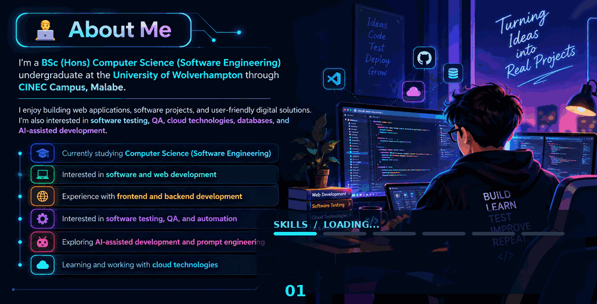

<!-- Animated profile header -->

 

  

<!-- Loading-style animated accent -->

---
## 👨‍💻 About Me

  

   
  🍄 Keep moving forward, one level at a time!

  

## 🛠️ Tech Stack

## 🚀 Featured Projects

### 🎬 Cinema Ticket Booking System

A Java-based cinema ticket booking application using **Java, MySQL, JDBC, RESTful Web Services, OOP, and JUnit**. Features include movie management, seat selection, reservations, payments, and reports.

### 🌦️ Weather Forecast Web Application

A web application that uses a live weather API to display current weather information.

## 🏆 GitHub Highlights

  
    
  

## 📫 Connect With Me

  
  

 

⭐ **Learning, building, testing, and improving — one project at a time.**

