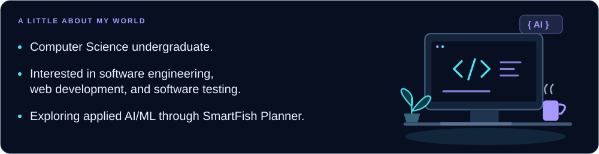
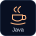
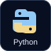
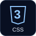
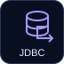
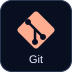

<picture>
  <source media="(prefers-reduced-motion: reduce) and (max-width: 600px)" srcset="assets/chamuditha-banner-mobile.png">
  <source media="(prefers-reduced-motion: reduce)" srcset="assets/chamuditha-github-banner.png">
  <source media="(max-width: 600px)" srcset="assets/chamuditha-banner-mobile.gif">
  <source media="(prefers-reduced-motion: no-preference)" srcset="assets/chamuditha-banner-animated.gif">
  
</picture>

# Hi, I'm Chamuditha 👋

I am Chamuditha Jayasanka, an undergraduate BSc (Hons) Computer Science student at the University of Wolverhampton, currently studying at CINEC Campus since 2024.

I have a strong interest in Software Engineering and Web Development, and I am continuously developing my skills in HTML, CSS, JavaScript, Java, and Database Systems through academic and personal projects.

I enjoy learning new technologies, solving programming challenges, and building modern software applications that improve user experiences and solve real-world problems.

I am seeking opportunities to gain industry experience, enhance my technical knowledge, and grow as a future software engineer.

  
  

<picture>
  <source media="(prefers-reduced-motion: reduce)" srcset="assets/neon-divider-static.png">
  
</picture>

## About me

<picture>
  <source media="(max-width: 600px)" srcset="assets/about-mobile.svg">
  
</picture>

## Featured research

### SmartFish Planner

**Final-year project · In progress**

I'm designing a planner for **7–30 day offshore tuna fishing trips in Sri Lanka**, combining:

- **Fishing-ground suitability** and marine forecasts.
- **Permitted fishing areas** to guide trip planning.
- **Boat-specific fuel and supply checks** for the planned trip.

The focus: bringing these inputs together to support practical decisions before heading offshore.

## Selected projects

- **[Cinemax →](https://github.com/ChamudithaJayasanka/My-Cinemax-Web-Project)** — A cinema-themed web project.
- **[Weather Forecast App →](https://github.com/ChamudithaJayasanka/NewWeatherApp)** — A weather forecast application.
- **[E-commerce Website →](https://github.com/ChamudithaJayasanka/Web-Development-Project)** — An e-commerce web project.

[View my GitHub contribution activity →](https://github.com/ChamudithaJayasanka#overview)

## Tech stack

**Languages**

   

**Web & databases**

   

**Testing & tools**

  

## GitHub activity

[Contributions & recent activity →](https://github.com/ChamudithaJayasanka#overview) · [Explore my repositories →](https://github.com/ChamudithaJayasanka?tab=repositories)
